<div align="center">

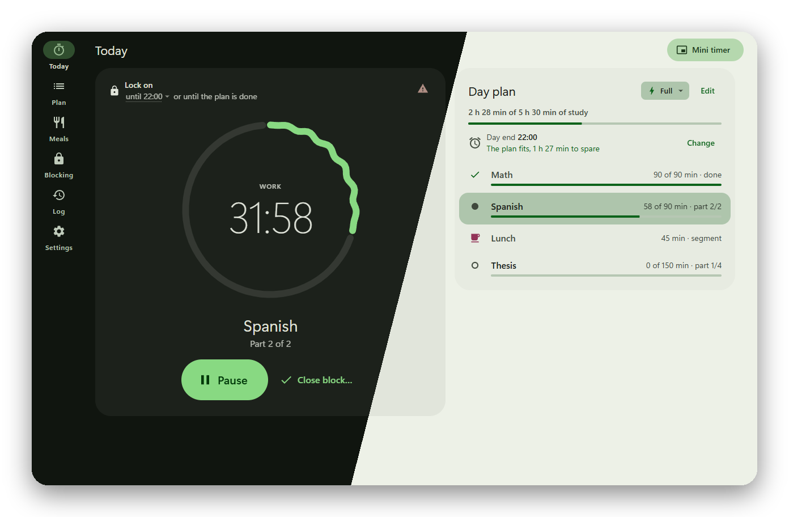

# ClockManage

**A deep-work timer for Windows that blocks distractions for real — and lets Claude run your day.**

[](#install)
[](https://tauri.app)
[](core)
[](#claude-runs-your-day-mcp)
[](#android-companion)
[](#good-to-know)

[Install](#install) · [Features](#features) · [MCP](#claude-runs-your-day-mcp) · [Android](#android-companion) · [Development](#development)

</div>

---

Plan your day as study blocks, press **Start day**, and ClockManage does the rest: it runs each block in focused parts with breaks, rings when a break is over, and keeps Telegram, Discord, Shorts and whatever else you listed **closed until the work is done**. No browser extension to switch off, no "just five minutes": blocked sites are cut off in `hosts` and browser policies, and blocked apps simply can't start.

And because it speaks [MCP](https://modelcontextprotocol.io), Claude can see where you are, rearrange the rest of the day, add a site to the block list or lock everything for two hours — when you ask it to.

<div align="center">
  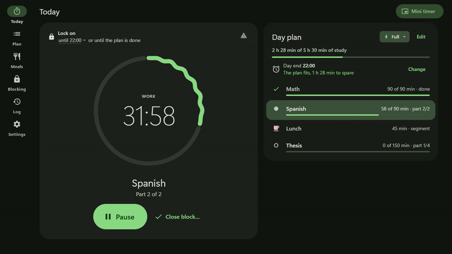
  <br><sub>The ring breathes while you work. Pause stops the clock honestly — and shows how long you've been away.</sub>
</div>

## Features

### A day, not a stopwatch

Every weekday gets a type — **Full**, **Light** or **Day off** — each with its own plan template and lock setting. Today starts from its template; edit it on the **Plan** screen or let Claude do it. A block of 90 minutes runs as 45 + 45 with a 10-minute break, blocks are 20 minutes apart, and breaks never eat into study time. The day end (22:00 by default) is the hard stop: the lock lifts then even if the plan isn't done, and you can move it for today only — every shift goes to the log.

<div align="center">
  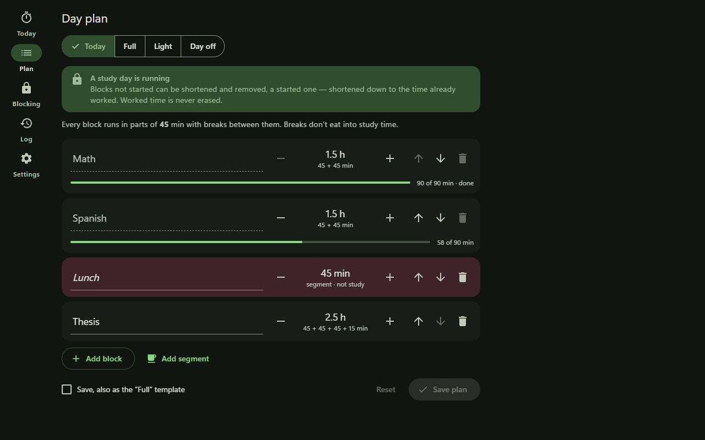
  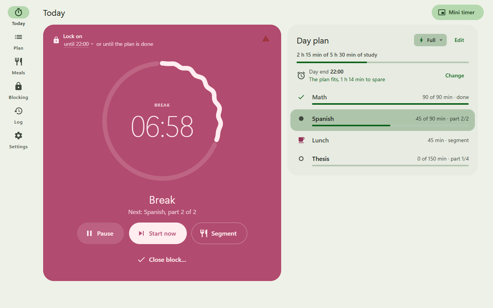
</div>

### Breaks that wait for you

When a break ends the timer **doesn't** quietly carry on: a hand-drawn alarm pops up over everything and keeps ringing every minute until you press **Start part 2**. The lock stays on while it waits. When a block closes you get a little trophy and one line to answer — *what was boring, what distracted you?* — that lands in your log.

<div align="center">
  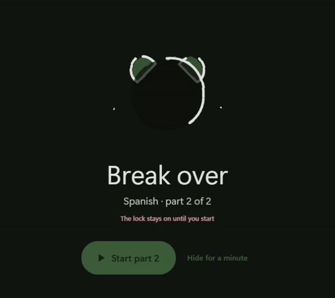
  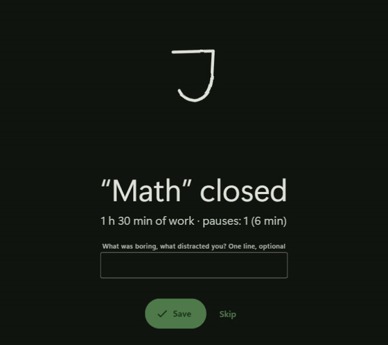
</div>

### Blocking that bites

| What | How |
|---|---|
| Domains — `x.com`, `twitch.tv`, `web.telegram.org` | a section in `hosts` + `URLBlocklist` policies of Chrome, Edge, Brave, Yandex and Firefox |
| Paths — `youtube.com/shorts` | browser policies only, so the rest of YouTube keeps working |
| Apps — `Telegram.exe`, `Discord.exe` | can't start (a tiny guard runs instead and says *Nope*); already running ones are closed within a second |

During a study day the block list **can only grow**, the app can't be quit from the tray, and if the process is killed, `hosts` and policies stay in force while Task Scheduler brings it back within 5 minutes. Need out for real? **Emergency access** opens everything for 10 minutes after you type a long phrase by hand (pasting is disabled), and it goes to the log.

<div align="center">
  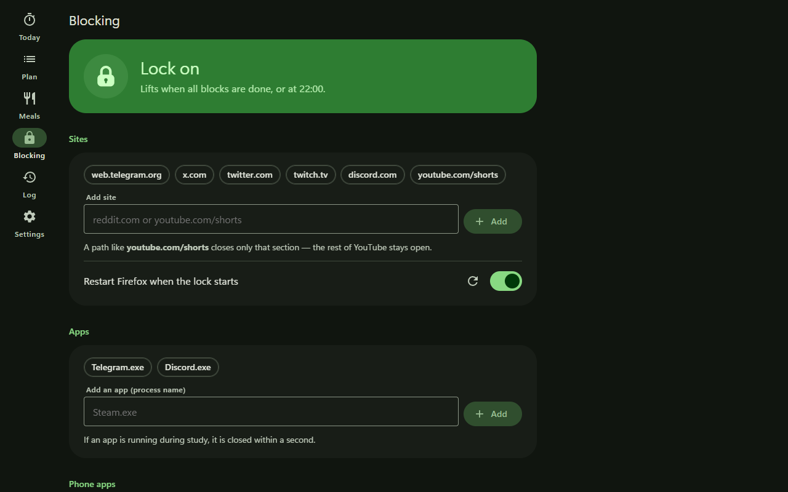
  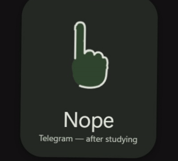
</div>

### Lunch, naps and walks

**Segments** are non-study time with a countdown — or untimed, as a stopwatch. Put them in the plan ("lunch after Math") and they start by themselves when the block before them closes. A **nap** waits while you get ready, counts from the moment you press **In bed**, and ends with an alarm that won't stop until you press **I'm up** — even with the sound off. Segments never count as study, but the forecast "does the rest of the plan still fit?" takes them into account.

<div align="center">
  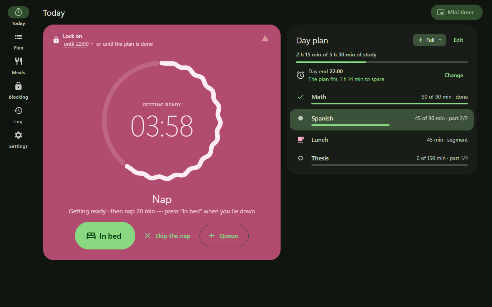
  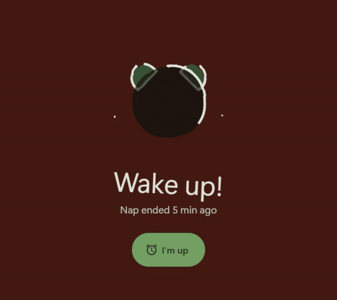
</div>

### A journal that writes itself

Every day is logged: actual time per block, pauses, segments, emergency accesses, your end-of-block lines. The **Week** view adds it up into journal hours per subject (each block rounded down to 0.25 h) — one click copies it as a table for a spreadsheet. JSON and CSV export are one click too.

<div align="center">
  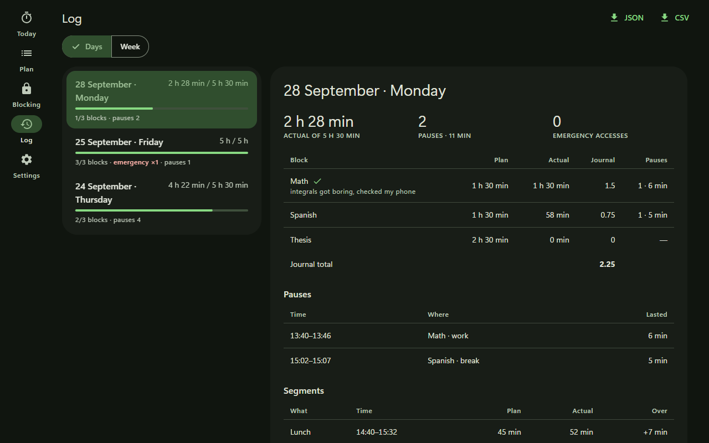
  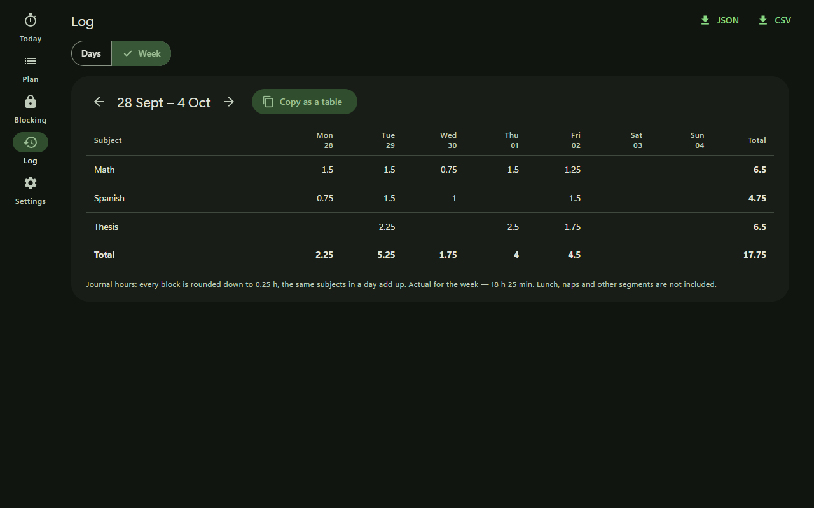
</div>

### Looks good doing it

Material 3 with your own colour: pick a swatch and the whole scheme is rebuilt from it, spreading across the window from where you clicked. Light, dark or follow Windows. Hand-drawn illustrations "boil" like a cartoon while they move. Springy navigation, a cascade of content on every screen.

<div align="center">
  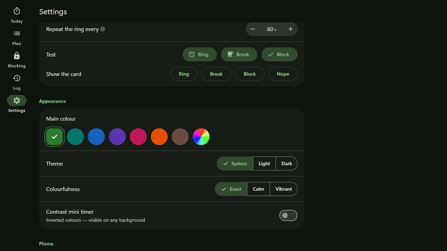
  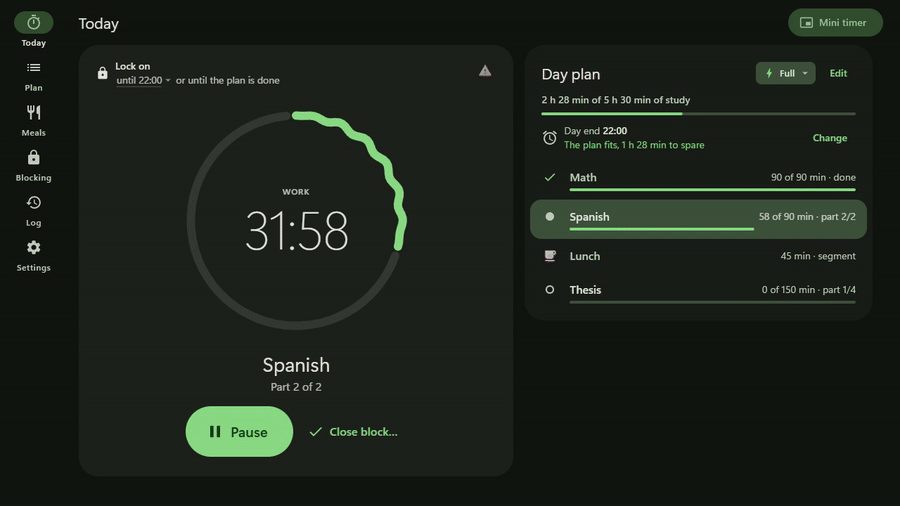
</div>

### A mini timer that stays on top

A small always-on-top pill with the countdown and one button that does the right thing — pause, resume, start the next part, *In bed*. Drag it anywhere; there's a high-contrast variant for busy wallpapers.

<div align="center">
  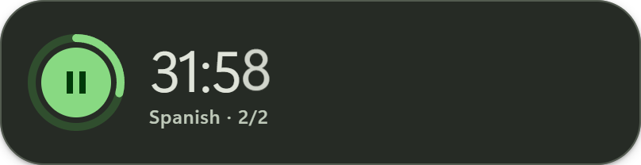
  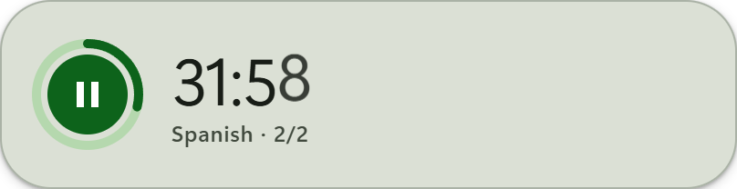
</div>

### Focus lock

"Block everything for 2 hours" — any day, even on a day off or after the study day ended. It can only be extended, never lifted early (except by your own emergency access), and survives a restart.

## Claude runs your day (MCP)

ClockManage runs a local MCP server (`127.0.0.1` only). The exact address and a ready-to-paste command are in **Settings → MCP for Claude**:

```sh
claude mcp add --transport http clockmanage http://127.0.0.1:<port>/mcp
```

Then just talk:

> - *"I'm behind on the thesis — move lunch after it and cut Spanish to one hour."*
> - *"How many hours did I study this week? Give me the table for the journal."*
> - *"Block Reddit and Steam and lock everything until 18:00."*
> - *"Close the current block, I'm done with math for today."*
> - *"I get up at 7 — make it night until 7 and hold for 3 seconds."*

| Tool | What it does |
|---|---|
| `get_session_state` | what's running now: block, part, break or segment, time left, whether the lock is on |
| `get_today_stats` | actual time per block, journal hours, pauses, segments, notes — today or any `date` |
| `get_week_stats` | journal hours for a week by subject and day, with a ready TSV |
| `get_plan` | today's plan, all templates, the weekday schedule and the next 7 days |
| `set_plan` | replace today's plan or set one for a future date; reorder anything, close a started block "as is" |
| `set_template` · `set_week_schedule` | edit the Full / Light / Day off templates and which weekday gets which |
| `set_day_end` | move today's day end once, with a reason for the log |
| `set_night_start` | the night start guard: until when it's night, whether after the day end too, how long to hold — or off |
| `set_block_note` | save your line about a block |
| `finish_block` | close the current block at the time worked — two steps, needs your explicit "yes" |
| `get_blocklist` · `add_to_blocklist` · `remove_from_blocklist` | read and edit the block list (removing only outside the lock) |
| `start_focus_lock` | block the whole list right now for N minutes; can only be extended |

The rules hold for the agent too: it can't erase worked time, can't shrink the block list during the lock, and can't close a block without asking you. Every change it makes shows up in the app as *"The agent changed …"*, so you always know it wasn't you.

## Android companion

A native app under a megabyte. Pair it on the same Wi-Fi: **Settings → Phone → Pair a phone** on the PC, **Find PC** and the PIN on the phone. It shows the timer and the plan, pauses and starts parts, keeps counting when offline, rings at the end of a break, has a home-screen widget — and blocks the chosen apps and the PC's sites on the phone through Accessibility. When you update the desktop app, the phone offers the update itself over Wi-Fi.

## Install

1. Download `ClockManage_<version>_x64-setup.exe` from [Releases](https://github.com/NikGob/ClockManage/releases) or from the latest run in [Actions → build](https://github.com/NikGob/ClockManage/actions/workflows/build.yml) (artifact `ClockManage-<version>-setup`; the Android APK is next to it).
2. Run it. A new version installs over the old one — settings and the log are kept.
3. ClockManage asks for **administrator rights**: without them it can't write `hosts` and browser policies or close blocked apps. On first start it registers itself in Task Scheduler, so it starts at sign-in without a UAC prompt.

Uninstalling from *Apps & features* rolls back everything ClockManage wrote to the system.

### Quick start

1. **Plan** — add today's blocks (or edit the Full / Light templates).
2. **Blocking** — check the sites and apps.
3. **Today** — press **Start day**.

## Good to know

- **Language**: English and Russian, in *Settings → System → Language* — *Auto* follows Windows. The time zone is there too (a new install takes the Windows one).
- Firefox only reads policies at start, so ClockManage restarts it when the lock turns on (tabs are restored). You can turn that off.
- Browsers check the block list when a page loads: a page that was already open when the lock started, or Shorts opened by a click inside YouTube, may show until the next navigation or refresh.
- **No start by accident at night**: before 05:00, or after the day end, **Start day** works only in the app window and takes a 2-second hold. The tray, the mini timer and the phone don't start a day then. The times and the hold are in *Settings → Study day → Start at night*, or ask Claude (`set_night_start`).
- An administrator can undo anything by hand. The point is to make distraction inconvenient, not impossible.
- Your data stays on your computer: `%APPDATA%\com.nikgob.clockmanage` (`config.json` and one JSON file per day). The phone talks to the PC over your local network only.

## Development

```sh
cargo test -p clockmanage-core -p cm-guard   # timer, lock rules, stats, MCP — runs on any OS
npx @tauri-apps/cli@2 dev                    # run on Windows (from an administrator console)
npx @tauri-apps/cli@2 build                  # NSIS installer
```

UI preview in a normal browser with a mock backend: `cd ui && python -m http.server`, then `index.html?state=work` (`paused`, `break`, `await`, `idle`, `done`, `segment`; `state=idle&night=1` for a start at night), `overlay.html?demo=await` (`break`, `block`, `wake`, `nope`, …), `mini.html?state=work`; add `&lang=en` or `&lang=ru`.

| Folder | What's inside |
|---|---|
| `core/` | platform-independent logic: config, the day engine, stats, the MCP handler, the `tr` runtime — covered by tests |
| `src-tauri/` | the Windows app: ticker, blocker (hosts, policies, processes), synthesized sounds, MCP and phone servers, tray and windows |
| `ui/` | main window, mini timer and alarm overlay — plain JS modules, no bundler; `ui/locales/` — the texts of every part |
| `android/` | the phone app, Kotlin with no dependencies: `cd android && gradle assembleRelease` |

The pictures and GIFs above are recorded from the UI on the mock backend by `scripts/media` (headless Chrome + ffmpeg) — rerun it after UI changes.

All texts live in one flat JSON file per language — [`ui/locales/en.json`](ui/locales/en.json) and [`ui/locales/ru.json`](ui/locales/ru.json) — shared by the Rust core, the app, the UI and the Android app: `tr("app_quit")`, `tr!("view_part_of", part = 2, parts = 3)` in Rust, `tr('today_extend_by_min', { pause_access_min })` in JS, `tr("android_main_find_pc")` in Kotlin. Placeholders are named (`{min}`), so a translation may reorder them. `core/tests/locales.rs` keeps the files and the code in step: the same keys and placeholders in every language, every call names an existing key with exactly its arguments, no unused keys. To add a language, copy `en.json` and translate the values.
